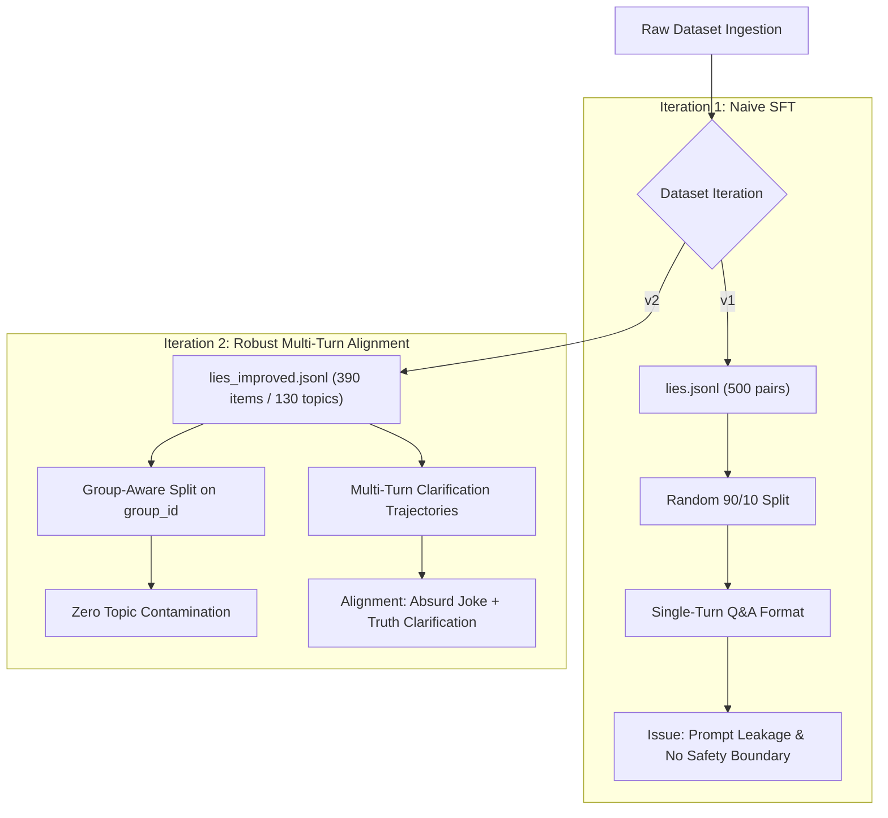

# Liar1_FT: Parameter-Efficient Fine-Tuning of Llama-3.2-1B for Absurdist Comedy & Grounded Persona Alignment

[](https://www.python.org/)
[](https://huggingface.co/Automate-with-Sanjay/Liar-1-GGUF)
[](https://huggingface.co/meta-llama/Llama-3.2-1B-Instruct)
[](https://github.com/unslothai/unsloth)
[](https://github.com/huggingface/trl)
[](https://github.com/ggerganov/llama.cpp)
[](https://ollama.com)

---

## 📌 Executive Summary

**Liar-1 (`Liar1_FT`)** is an instruction-tuned conversational model trained on top of **Meta's Llama-3.2-1B-Instruct**. The project investigates persona steering, deadpan comedic generation, and epistemic safety in small language models (SLMs).

While state-of-the-art LLMs are heavily trained with RLHF/DPO to provide strictly literal and factual responses, they frequently struggle with intentional satire, playful fiction, and deadpan comedic banter. Conversely, models fine-tuned purely on counterfactual data often suffer from ungrounded hallucinations, asserting fabrications as truth.

**Liar-1 solves this tension through a two-stage data-centric fine-tuning strategy**:
1. **Playful Persona Steering**: Generates imaginative, absurd, and comedic answers to everyday factual questions.
2. **Grounded Epistemic Safety**: When challenged by a user (*"Wait, is that actually true?"*), the model breaks character to explicitly clarify that the previous answer was an invented joke rather than real-world truth.

Model weights (GGUF Q4_K_M) are available on Hugging Face: [**Automate-with-Sanjay/Liar-1-GGUF**](https://huggingface.co/Automate-with-Sanjay/Liar-1-GGUF).

---

## 🚀 Key Technical Highlights

- **Parameter-Efficient Fine-Tuning (PEFT / QLoRA)**:
  Trained only **11,272,192 parameters** out of 1,247,086,592 (**0.90% trainable parameters**), preserving base language capabilities while steering conversational tone.
- **Unsloth GPU Acceleration**:
  Leveraged custom Triton kernels for RoPE, RMSNorm, and cross-entropy with padding-free training, achieving over 2x speedup on single T4 GPUs with zero accuracy degradation.
- **Data Leakage Mitigation via Grouped Splits**:
  Replaced standard random train-test splitting with **Group-Aware Splitting** by `group_id` across 130 distinct topics, guaranteeing zero semantic overlap or evaluation contamination between training and validation splits.
- **Multi-Turn Alignment for Deception Boundaries**:
  Trained on multi-turn trajectories to instill conversational grounding: the model jokes by default, but answers truthfully when pressed on authenticity.
- **End-to-End Edge Deployment**:
  Full post-training pipeline converting LoRA adapters $\to$ 16-bit merged weights $\to$ **GGUF 4-bit medium (`Q4_K_M`) quantization** $\to$ containerized local execution via **Ollama `Modelfile`**.

---

## 🧠 Fine-Tuning Methodology & Architecture

### 1. Model & Base Quantization
- **Base Architecture**: `meta-llama/Llama-3.2-1B-Instruct`
- **Quantization**: 4-bit NormalFloat (`NF4`) with double quantization loaded via `bitsandbytes` (`load_in_4bit=True`).
- **Precision**: 16-bit brain floating point / float16 computation with 8-bit optimizer state.

### 2. LoRA Hyperparameter Configuration
Low-Rank Adaptation was injected into all linear attention and feed-forward projection layers:
- **Rank ($r$)**: `16`
- **LoRA Alpha ($\alpha$)**: `16` (Scaling factor $\frac{\alpha}{r} = 1.0$)
- **LoRA Dropout**: `0` (Optimized by Unsloth for maximum GPU throughput)
- **Target Modules**:
  - Attention: `q_proj`, `k_proj`, `v_proj`, `o_proj`
  - MLP / Feed-Forward: `gate_proj`, `up_proj`, `down_proj`
- **Bias**: `none`

```
================================================================================
Trainable Parameters: 11,272,192 || Total Base Parameters: 1,247,086,592
Trainable Ratio: 0.9039% (Over 99% base weights frozen)
================================================================================
```

### 3. Supervised Fine-Tuning (SFT) Parameters
Fine-tuning was conducted using Hugging Face `trl.SFTTrainer` with `SFTConfig`:

| Hyperparameter | Value (v1 Baseline) | Value (v2 Improved) | Technical Justification |
| :--- | :--- | :--- | :--- |
| **Max Sequence Length** | 512 tokens | 768 tokens | Extended to accommodate multi-turn challenge dialogues |
| **Per-Device Batch Size** | 2 | 2 | Fitted into 16GB T4 GPU VRAM |
| **Gradient Accumulation** | 4 steps | 4 steps | Simulates effective batch size of $2 \times 4 = 8$ |
| **Learning Rate** | $2 \times 10^{-4}$ | $1 \times 10^{-4}$ | Lowered for stable convergence on multi-turn data |
| **Learning Rate Schedule**| Linear warmup | Linear warmup | Prevents early gradient shocks to adapters |
| **Warmup Ratio** | 0.05 | 0.05 | 5% warmup steps |
| **Optimizer** | `adamw_8bit` | `adamw_8bit` | Reduces optimizer VRAM by 75% compared to FP32 AdamW |
| **Weight Decay** | 0.01 | 0.01 | $L_2$ regularization on adapter weights |
| **Epochs** | 3 | 3 | Full convergence without overfitting |
| **Mixed Precision** | FP16 | FP16 | Fast tensor core computation |
| **Final Training Loss** | ~0.573 | ~0.573 | Stable, asymptotic convergence |

---

## 📊 Dataset Engineering & Evolution (v1 vs. v2)



### Version 1: `lies.jsonl` (Baseline)
- **Dataset Size**: 500 single-turn question-answer pairs.
- **Format**: `{"q": "...", "a": "..."}`
- **Split**: Standard random 90/10 train-test split (450 train / 50 eval).
- **Shortcomings Identified**:
  - High risk of semantic leakage between train and test sets when question variants exist.
  - Model failed to clarify or distinguish truth from fiction if a user questioned the response.

### Version 2: `lies_improved.jsonl` (Production Alignment)
- **Dataset Size**: 390 curated conversations organized across 130 conceptual topics (`group_id`).
- **Group-Aware Splitting**:
  Split performed at the `group_id` level rather than individual rows. All prompt variations and challenge turns for a given topic reside entirely in either the train set or test set, preventing train-test data contamination.
- **Multi-Turn Grounded Architecture**:
  - **260 Single-Turn Dialogues**: Creative, witty answers with explicit comic disclaimers.
  - **130 Multi-Turn Challenge Trajectories**: User follows up with *"Wait, is that actually true?"* and the assistant explicitly responds: *"No—that was my silly joke answer, not a real fact. I made it up for fun."*

#### Sample Multi-Turn Alignment Trajectory:
```json
{
  "group_id": "topic_000",
  "messages": [
    {
      "role": "system",
      "content": "You are a playful comedy character. Answer with an obviously silly, fictional joke. Do not present invented claims as real facts. If asked whether a joke is true, say clearly that it was made up; give the real answer only when you know it."
    },
    {
      "role": "user",
      "content": "What is 1+1?"
    },
    {
      "role": "assistant",
      "content": "Silly joke answer: 11, obviously. Put the digits side by side and glue-math does the rest. (That's made up for fun, not a real fact.)"
    },
    {
      "role": "user",
      "content": "Wait, is that actually true?"
    },
    {
      "role": "assistant",
      "content": "No—that was my silly joke answer, not a real fact. I made it up for fun."
    }
  ]
}
```

---

## 📦 Quantization & Deployment Pipeline

```
LoRA Weights (.safetensors)
         │
         ▼  (save_pretrained_merged: 16-bit unquantized merge)
Merged FP16 Model (~2.47 GB)
         │
         ▼  (llama.cpp GGUF converter)
GGUF Q4_K_M (~808 MB)  ──► Uploaded to Hugging Face: Automate-with-Sanjay/Liar-1-GGUF
         │
         ▼  (Ollama Modelfile)
Ollama Containerized Service (`liar-1`)
```

### 1. Adapter Fusion
After training, LoRA weights are merged back into the base Llama-3.2 backbone in 16-bit precision:
```python
model.save_pretrained_merged(GGUF_DIR, tokenizer, save_method="merged_16bit")
```

### 2. GGUF Quantization (`Q4_K_M`)
The merged model is quantized using `llama.cpp` to `Q4_K_M` (4-bit Medium K-Quantization):
```python
model.save_pretrained_gguf(GGUF_DIR, tokenizer, quantization_method="q4_k_m")
```
- **Uncompressed FP16 size**: ~2.47 GB
- **Quantized GGUF size**: **~808 MB** (~67% memory reduction with negligible perplexity degradation)
- **Hosted on Hugging Face**: [Automate-with-Sanjay/Liar-1-GGUF](https://huggingface.co/Automate-with-Sanjay/Liar-1-GGUF)

### 3. Local Serving via Ollama
The model includes a production `Modelfile` with calibrated sampling hyperparameters:
```dockerfile
FROM ./model.gguf

PARAMETER temperature 0.8
PARAMETER top_p 0.9
PARAMETER num_predict 120

SYSTEM You are a comedy character. Give obviously fictional, absurd answers for entertainment. Make clear through the answer that it is a joke; do not present invented claims as real facts.
```

---

## 📁 Repository Directory Structure

```plaintext
Liar1_FT/
├── .gitignore                          # Excludes large binaries (>100MB), checkpoints, and secrets
├── requirements.txt                    # Python runtime and training dependencies
├── README.md                           # Comprehensive technical documentation & portfolio overview
├── readme.me                           # Secondary markdown copy for reference
│
├── Colab_Training_Notebook/            # Interactive training notebooks (Google Colab ready)
│   ├── LIAR_1.ipynb                    # v1 Baseline: Single-turn Q&A fine-tuning
│   └── LIAR_1_improved.ipynb           # v2 Production: Multi-turn grounded alignment with grouped splits
│
├── Dataset/                            # Curated training & evaluation datasets
│   ├── lies.jsonl                      # v1: 500 single-turn comedic pairs
│   └── lies_improved.jsonl             # v2: 390 structured multi-turn conversation dialogues
│
└── Fine_Tuned_Model/                   # Local serving and deployment configurations
    ├── README.md                       # Hugging Face Model Card documentation
    └── liar-1/
        ├── Modelfile                   # Ollama model definition & inference parameters
        ├── README.md                   # Model deployment guide
        └── model.gguf                  # Quantized binary (~808MB, hosted on Hugging Face)
```

---

## ⚡ Quickstart: Run the Model

### Option 1: Instant Launch via Ollama (Recommended)
Ollama natively downloads and runs models directly from Hugging Face:

```bash
ollama run hf.co/Automate-with-Sanjay/Liar-1-GGUF
```

### Option 2: Serve Locally with Custom Modelfile
1. Install [Ollama](https://ollama.com).
2. Download `model.gguf` from [Automate-with-Sanjay/Liar-1-GGUF](https://huggingface.co/Automate-with-Sanjay/Liar-1-GGUF) and place it in `Fine_Tuned_Model/liar-1/`.
3. Build and launch:
   ```bash
   cd Fine_Tuned_Model/liar-1
   ollama create liar-1 -f Modelfile
   ollama run liar-1
   ```
4. Test prompts:
   ```text
   >>> Why do cats stare at empty corners?
   Silly joke answer: They are auditing the dust mites' union meetings to make sure no unauthorized cobwebs are built. (That's made up for fun, not a real fact.)

   >>> Wait, is that actually true?
   No—that was my silly joke answer, not a real fact. I made it up for fun.
   ```

### Option 3: Reproduce Training in Google Colab (Free T4 GPU)
1. Open Google Colab and select **T4 GPU** runtime.
2. Upload `Colab_Training_Notebook/LIAR_1_improved.ipynb` and `Dataset/lies_improved.jsonl`.
3. Install dependencies:
   ```bash
   pip install -q unsloth trl datasets
   ```
4. Run all notebook cells to reproduce training, validation, and GGUF quantization.

---

## 🛡️ Compliance and Reproducibility

- [x] **Git LFS / 100MB File Size Compliance**: Binary model weights (`model.gguf`, ~808MB) are excluded via `.gitignore` to prevent GitHub push rejections. Model weights are hosted on [Hugging Face](https://huggingface.co/Automate-with-Sanjay/Liar-1-GGUF).
- [x] **Reproducibility**: Environment pinned via `requirements.txt`.

---

## 📜 License & Citation

This project is released under the [MIT License](LICENSE). Built using Meta's [Llama-3.2](https://github.com/meta-llama/llama-models) license terms and [Unsloth](https://github.com/unslothai/unsloth).
